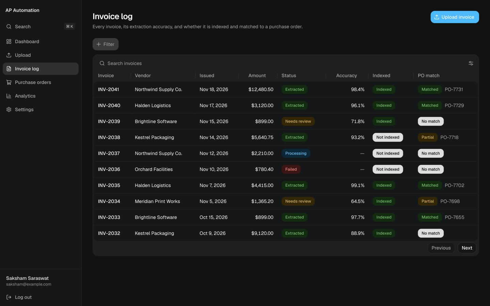
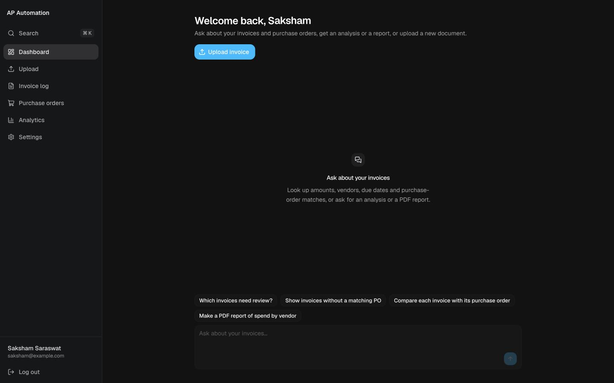
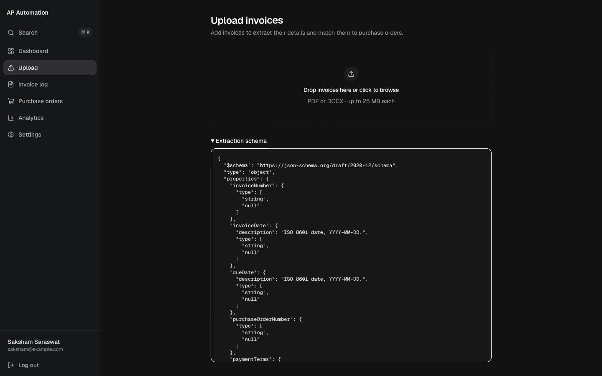
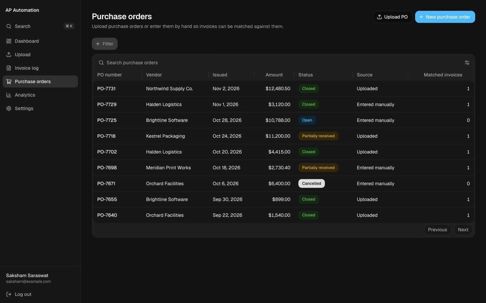
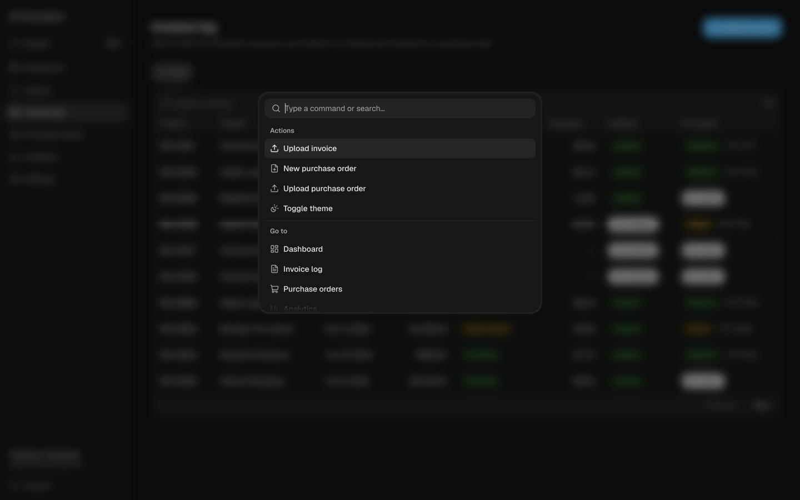
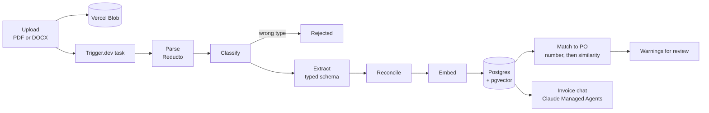

<div align="center">

# AP Automation

**Accounts payable that reads its own paperwork.**

Upload invoices and purchase orders, get structured data back, have every invoice matched and checked against its purchase order, and ask an AI analyst about the result.

[](https://nextjs.org) [](https://react.dev) [](https://www.typescriptlang.org) [](https://github.com/pgvector/pgvector) [](https://trigger.dev) [](https://turborepo.com)

[Features](#features) · [Screenshots](#screenshots) · [How it works](#how-it-works) · [Getting started](#getting-started) · [Security](#security)

<br />



</div>

## About

Accounts payable teams spend most of their time retyping invoices and comparing them with purchase orders by eye. AP Automation does both steps for them.

A PDF or DOCX goes in. A background pipeline parses it, confirms it is the kind of document it claims to be, extracts every field into a typed schema, and stores it with a vector embedding. Each invoice is then linked to its purchase order, first by the PO number printed on it and otherwise by similarity, and the two are compared line by line. Anything that does not add up is flagged for a reviewer instead of being passed along.

On top of that data sits a chat analyst. It runs in its own sandbox with a snapshot of the organization's documents, computes its answers with code, and can hand back PDF or spreadsheet reports.

## Features

- **Document ingestion.** Drop in invoices or purchase orders as PDF or DOCX, up to 25 MB each. Progress is reported stage by stage while the document is processed.
- **Typed extraction.** Vendor, customer, dates, payment terms, totals, tax and line items are extracted into a [Zod schema](apps/web/lib/invoice-schema.ts). The upload page shows the exact JSON Schema in use.
- **Reconciliation checks.** Deterministic checks run on the extracted numbers, such as whether line items add up to the subtotal. Mismatches become reviewer warnings.
- **Purchase order matching.** An invoice is linked by exact PO number, or by embedding similarity (cosine, 0.85 or higher) when it prints none. Vendor, currency, total and line items are then compared against the order.
- **Late purchase orders.** When a purchase order arrives after its invoices, the waiting invoices are linked and checked at that point.
- **Invoice chat.** Ask "Which invoices need review?" or "Make a PDF report of spend by vendor". The analyst works from the data with Python and returns files as downloads.
- **Organizations and roles.** WorkOS AuthKit sign-in, organization onboarding, and four roles: admin, editor, user and viewer.
- **Command menu.** Press <kbd>⌘</kbd> <kbd>K</kbd> to jump to any page or start an upload.
- **Security baseline.** Field-level envelope encryption, a nonce-based CSP, HSTS, and a configuration that refuses to boot when it is unsafe for production.

## Screenshots

<table>
  <tr>
    <td width="50%">
      
      <p align="center"><b>Dashboard.</b> Chat with an analyst that knows your invoices.</p>
    </td>
    <td width="50%">
      
      <p align="center"><b>Upload.</b> Drop documents in and see the schema they are extracted into.</p>
    </td>
  </tr>
  <tr>
    <td width="50%">
      
      <p align="center"><b>Purchase orders.</b> Upload them or enter them by hand.</p>
    </td>
    <td width="50%">
      
      <p align="center"><b>Command menu.</b> Every action and page from the keyboard.</p>
    </td>
  </tr>
</table>

## How it works



**Ingestion** runs as Trigger.dev tasks in [`apps/web/src/trigger`](apps/web/src/trigger). Invoices and purchase orders share one pipeline: parse with Reducto, classify, extract with a schema, reconcile, embed, save, link. The classification and extraction calls go through Vercel AI Gateway. The document is treated as untrusted input throughout, so text inside an invoice cannot steer the model.

**Matching** lives in [`apps/web/lib/po-matching.ts`](apps/web/lib/po-matching.ts). The checks are pure functions with no I/O, which keeps them easy to test. Company names are compared with suffixes such as "Inc" and "Ltd" removed, so "Northwind Supply Co." still matches "Northwind Supply".

**Chat** runs on Claude Managed Agents. Each conversation is a session with its own sandbox holding a snapshot of the organization's invoices and purchase orders. The sandbox has a Python reporting stack and no network access beyond package registries, so document data cannot leave it. The agent and its environment are defined in [`apps/web/lib/chat/agent-config.ts`](apps/web/lib/chat/agent-config.ts).

## Tech stack

| Area | Technology |
| --- | --- |
| Framework | [Next.js 16](https://nextjs.org) (App Router), [React 19](https://react.dev), TypeScript |
| UI | [Cubby UI](https://www.cubby-ui.dev) on Base UI, Tailwind CSS 4 |
| Auth | [WorkOS AuthKit](https://workos.com/docs/authkit) |
| Database | [Neon](https://neon.com) Postgres with pgvector, [Drizzle ORM](https://orm.drizzle.team) |
| Background jobs | [Trigger.dev](https://trigger.dev) v4 |
| Parsing | [Reducto](https://reducto.ai) |
| AI | [AI SDK](https://ai-sdk.dev) through Vercel AI Gateway, Claude Managed Agents for the chat |
| File storage | [Vercel Blob](https://vercel.com/docs/vercel-blob) (private store) |
| Tooling | [Turborepo](https://turborepo.com), [Ultracite](https://www.ultracite.ai), Node test runner |

## Getting started

### Prerequisites

- Node.js 20.9 or later, and npm
- A [Neon](https://neon.com) Postgres database
- A [WorkOS](https://workos.com) account with AuthKit enabled
- A [Trigger.dev](https://trigger.dev) project
- API keys for [Reducto](https://studio.reducto.ai), [Vercel AI Gateway](https://vercel.com/ai-gateway) and [Anthropic](https://console.anthropic.com)

### 1. Install

```bash
git clone https://github.com/sushii2/ap-automation.git
cd ap-automation
npm install
```

### 2. Configure the environment

```bash
cp apps/web/.env.example apps/web/.env.local
npm run keys:generate
```

Paste the generated encryption keys into `apps/web/.env.local`, then fill in the rest. Each variable is documented in [`apps/web/.env.example`](apps/web/.env.example).

| Variable | Used for |
| --- | --- |
| `ENCRYPTION_*`, `BLIND_INDEX_KEY` | Field-level encryption. Generated by `npm run keys:generate`. |
| `DATABASE_URL`, `DATABASE_URL_UNPOOLED` | Neon Postgres. The unpooled URL is only used for migrations. |
| `WORKOS_API_KEY`, `WORKOS_CLIENT_ID`, `WORKOS_COOKIE_PASSWORD` | Sign-in and organizations. |
| `TRIGGER_SECRET_KEY` | Starting ingestion runs. |
| `REDUCTO_API_KEY`, `AI_GATEWAY_API_KEY` | Parsing, classification, extraction and embeddings. |
| `ANTHROPIC_API_KEY`, `CHAT_AGENT_ID`, `CHAT_ENVIRONMENT_ID` | Invoice chat. Without these the chat is switched off. |
| `BLOB_READ_WRITE_TOKEN` | Storing uploads. Optional locally: documents are parsed but not saved. |

In the WorkOS dashboard, set the redirect URI to `http://localhost:3000/callback` and the sign-in endpoint to `http://localhost:3000/sign-in`.

### 3. Set up the database, roles and chat agent

```bash
npm run db:migrate -w web      # apply the migrations in apps/web/drizzle
npm run workos:roles -w web    # create the admin, editor, user and viewer roles in WorkOS
npm run chat:agent -w web      # create the chat agent and sandbox, and print their IDs
```

Add the printed `CHAT_AGENT_ID` and `CHAT_ENVIRONMENT_ID` to `.env.local`. Run `chat:agent` again after editing the agent config and it updates both in place.

### 4. Run

```bash
npm run dev                    # the web app on http://localhost:3000
```

```bash
npm run dev:trigger -w web     # the ingestion tasks, in a second terminal
```

The ingestion tasks write to the database, so the Trigger.dev project needs `DATABASE_URL`, `AI_GATEWAY_API_KEY`, `REDUCTO_API_KEY` and the encryption variables as well.

## Project structure

```
apps/web                 Next.js app
├── app/(app)            Signed-in pages: dashboard, upload, invoices, purchase orders, analytics, settings
├── lib/chat             Invoice chat: agent config, sessions, event stream
├── lib/db               Drizzle schema and queries
├── lib/po-matching.ts   Invoice to purchase order checks
├── src/trigger          Ingestion tasks
└── drizzle              SQL migrations
packages/ui              Cubby UI components and theme (@workspace/ui)
packages/crypto          Field-level envelope encryption (@workspace/crypto)
packages/typescript-config
```

## Scripts

Run these from the repository root.

| Command                         | What it does                               |
| ------------------------------- | ------------------------------------------ |
| `npm run dev`                   | Start every app in development             |
| `npm run build`                 | Production build                           |
| `npm run test`                  | Unit tests (Node test runner)              |
| `npm run typecheck`             | TypeScript across the workspace            |
| `npm run check`                 | Lint and format check with Ultracite       |
| `npm run fix`                   | Apply lint and format fixes                |
| `npm run db:generate -w web`    | Write a migration after editing the schema |
| `npm run db:migrate -w web`     | Apply pending migrations                   |
| `npm run db:studio -w web`      | Open Drizzle Studio                        |
| `npm run deploy:trigger -w web` | Deploy the ingestion tasks to Trigger.dev  |

To add a Cubby UI component:

```bash
cd packages/ui && npx shadcn@latest add @cubby-ui/<component>
```

Import it from `@workspace/ui/components/ui/cubby-ui/<component>`.

## Security

Invoices carry bank details, tax IDs and sometimes health information, so the project treats security as a baseline requirement.

- **At rest.** AES-256-GCM envelope encryption per field, with the tenant, table, column and row bound into each ciphertext. A value copied to another row or tenant fails to decrypt. Blind indexes allow exact-match lookups on encrypted fields.
- **In transit.** HSTS, a nonce-based Content Security Policy, and an HTTPS redirect behind the proxy.
- **Fail closed.** In production the app refuses to boot with a local keyring, a non-HTTPS `APP_URL`, or a database URL without `sslmode=verify-full`.
- **Untrusted documents.** Uploaded documents are never allowed to instruct the models that read them, and the chat sandbox has no web access.

[SECURITY.md](SECURITY.md) has the full control list and its mapping to SOC 2, ISO 27001 and HIPAA.

## Project status

AP Automation is under active development and is not production-ready yet.

- Ingestion, storage, embeddings, purchase order matching and the invoice chat work end to end.
- The invoice log and purchase orders tables currently render sample data and are not wired to the database yet.
- Analytics widgets are placeholders.
- The KMS key provider and audit log are not built yet. See the "Not yet done" section of [SECURITY.md](SECURITY.md).

## Contributing

Issues and pull requests are welcome. Before opening a pull request:

```bash
npm run fix
```

```bash
npm run typecheck && npm run test
```

Code standards are enforced by Ultracite and described in [AGENTS.md](AGENTS.md).

## License

No license has been chosen yet. Until one is added, all rights are reserved by the author.
